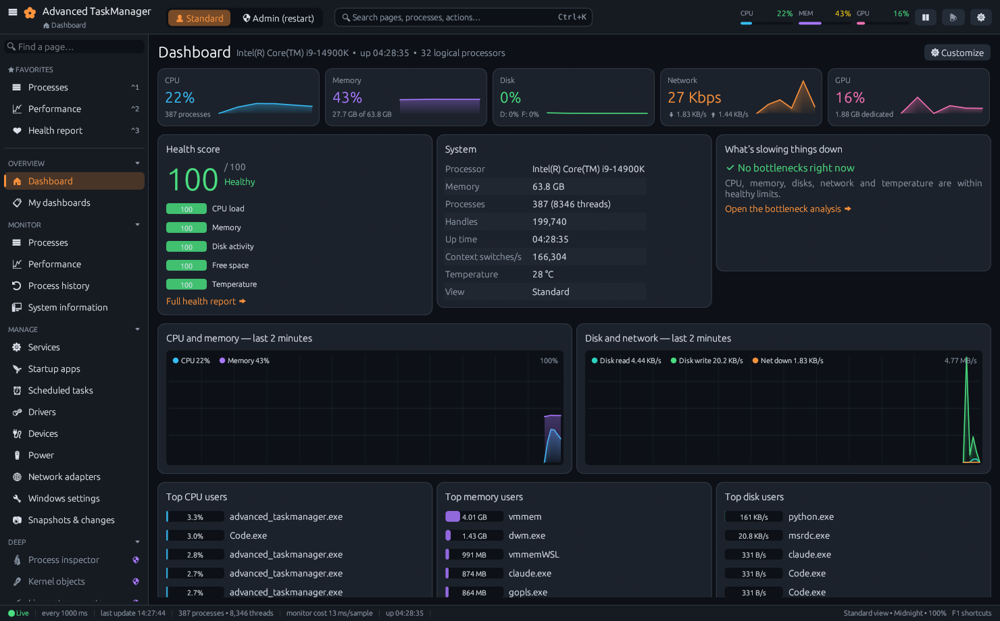

# Advanced TaskManager

**A modern, low-overhead task manager for Windows that shows every detail the built-in Task Manager hides.**
Written in Rust with [egui](https://github.com/emilk/egui). One small program, no installer, no background service, no telemetry.



---

## Highlights

| Area | What you get |
|---|---|
| **Monitoring core** | Live dashboard, process explorer with tree view, 40+ columns, CPU (per core, kernel/DPC/interrupt time, clock), memory composition (in use / modified / standby / free / compressed / pools), physical disks (active time, queue, response time), network adapters, GPU engines and memory, per-process GPU use. |
| **Two views** | **Standard view** for everyday use. **Admin view** (runs as administrator) adds threads, modules, memory maps, handles, security tokens, kernel objects, live system events (ETW) and full control. |
| **Disk space analyzer** | Scan any drive or folder and see every folder's size and share of its parent, the largest files (with name, wildcard and type filters), space per file type, duplicate files and a zoomable colour treemap. Whole NTFS drives scan in seconds in the Admin view by reading the drive's file table directly. Export to CSV, copy paths, open in Explorer or a command prompt, move to the Recycle Bin. |
| **Uninstaller & clean-up** | Uninstall programs (normal, quick/silent or forced), then scan for leftovers in the registry, program folders, app data, Start menu and desktop (safe / moderate / advanced) — every registry key is backed up first, files go to the Recycle Bin, and items shared with other installed programs are left unticked. Uninstall history, Windows (Store) apps, browser extensions for Chrome, Edge, Brave, Vivaldi, Opera and Firefox, junk-file cleaner, privacy cleaner, secure file delete, registry backups and restore points, and a launcher for 23 Windows tools. |
| **System management** | Services, startup apps (Run keys, startup folders, logon tasks, auto-start services), scheduled tasks, drivers (with signatures and loaded kernel modules), device inventory with problem codes, power plans and battery, network adapters (addresses, DNS, gateways), Windows security/configuration, configuration snapshots and change tracking. |
| **Deep observability** | Thread inspection with start addresses and wait reasons, memory maps, handle inspection, live ETW tracing, Event Viewer, diagnostics timeline, CSV performance recording, one-hour historical graphs, hardware sensors, SSD/disk health. |
| **Intelligence** | Health score, bottleneck detection, process behaviour classification, memory/handle/thread leak candidates, startup impact analysis, spike-to-event correlation, recommendations, change impact analysis, HTML health report. |
| **Automation** | Rule engine (metric + threshold + duration → alert, end, suspend, priority, efficiency mode, script, recording, profile), alerts, system profiles, per-process profiles, scheduled monitoring, script library, JSON export, custom dashboards. |
| **Your way** | Six themes, any accent colour, zoom, text size, density, graph style, favorites, hideable pages, command palette (Ctrl+K), keyboard shortcuts, column sets and ordering. |

More pictures: [uninstaller](docs/images/uninstaller.png) · [disk space analyzer](docs/images/diskspace.png) · [processes](docs/images/processes.png) · [performance](docs/images/performance.png) · [health report](docs/images/health.png) · [settings](docs/images/settings.png) · [light theme](docs/images/light.png)

A detailed, illustrated tour is on the project website: **<https://toolsbyjs.github.io/Advanced-task-manager/>** (source: [`docs/website/index.html`](docs/website/index.html)).

## Download

Get `advanced_taskmanager.exe` from the [latest release](https://github.com/toolsbyjs/Advanced-task-manager/releases/latest). There's nothing to install: run the program, and remove it by deleting the file. Each release includes a `SHA256SUMS.txt` checksum file.

## Requirements

- Windows 10 (1809) or Windows 11, 64-bit
- About 30 MB of memory while running
- Administrator rights only for the Admin view
- To build: Rust 1.80 or newer (stable, MSVC toolchain)

## Build from source

```powershell
git clone https://github.com/toolsbyjs/Advanced-task-manager.git
cd Advanced-task-manager
cargo build --release
.\target\release\advanced_taskmanager.exe
```

The first window opens in the **Standard view**. Click **🛡 Admin** in the top bar to restart it as administrator (Windows asks you to confirm).

### Useful start-up options

| Option | Meaning |
|---|---|
| `--page <name>` | Open a page directly: `dashboard`, `processes`, `performance`, `services`, `startup`, `health`, `timeline`, `graphs`, `settings`, … |
| `--theme <name>` | Use a theme for this run: `Midnight`, `Graphite`, `Ocean`, `Forest`, `Light`, `High contrast` |
| `--compact` | Start with the icons-only sidebar |
| `--scan <drive or folder>` | Open the Disk space analyzer and scan straight away, e.g. `--scan D:\` |
| `--leftovers-test <name> <file>` | Write what a leftover scan would find for a program to a text file (deletes nothing) |
| `--screenshot <file.png>` | Start without taking focus, draw, save a picture of the window and exit (used by automated checks) |

## Keyboard shortcuts

| Keys | Action |
|---|---|
| Ctrl+K | Command palette — jump to any page, process or action |
| Ctrl+F | Search processes |
| Ctrl+P | Pause / resume live updates |
| Ctrl+B | Collapse / expand the sidebar |
| Ctrl+1 … 9 | Open favorite pages |
| Ctrl + / − / 0 | Zoom |
| Delete | End the selected process (asks first) |
| Esc | Close dialogs / details |
| F1 | Show all shortcuts |

## Where your data lives

Settings, snapshots, recordings, reports, dumps, uninstall history and the Uninstaller's registry backups are stored in `%APPDATA%\AdvancedTaskManager`. Nothing is sent anywhere. See [PRIVACY.md](PRIVACY.md).

## Documentation

| Document | For |
|---|---|
| [User guide](docs/USER_GUIDE.md) | Every page explained, safety nets, tips and FAQ |
| [Feature reference](docs/FEATURES.md) | All 46 pages on one page: what each does, what needs the Admin view, command-line names |
| [Developer guide](docs/DEVELOPER_GUIDE.md) | Building, debugging, adding pages, columns, rules and data sources |
| [Architecture](docs/ARCHITECTURE.md) | How the sampler, Windows readers and UI fit together |
| [Contributing](CONTRIBUTING.md) | How to propose changes |
| [Code of conduct](CODE_OF_CONDUCT.md) | How we treat each other |
| [Security policy](SECURITY.md) | Reporting vulnerabilities, safety design |
| [Privacy policy](PRIVACY.md) | What the app reads and stores |
| [Changelog](CHANGELOG.md) | What changed in each version |
| [Third-party notices](THIRD_PARTY_NOTICES.md) | Licences of the libraries used |
| [Licence](LICENSE) | MIT |

## Project home

Source, issues and releases: <https://github.com/toolsbyjs/Advanced-task-manager>. Website: <https://toolsbyjs.github.io/Advanced-task-manager/>.

## Licence

Released under the [MIT Licence](LICENSE). © 2026 Advanced TaskManager contributors.
