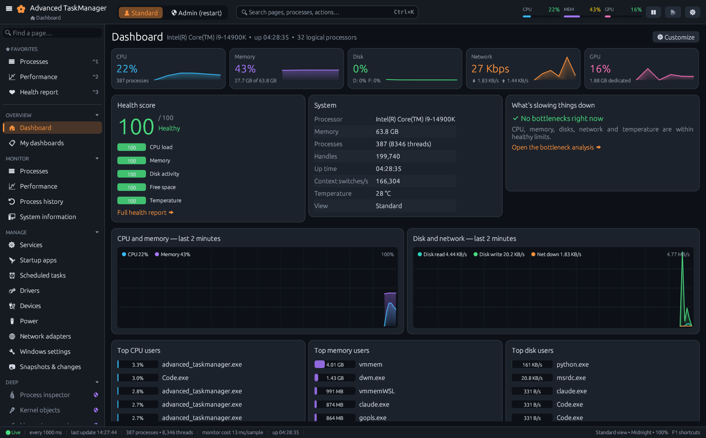
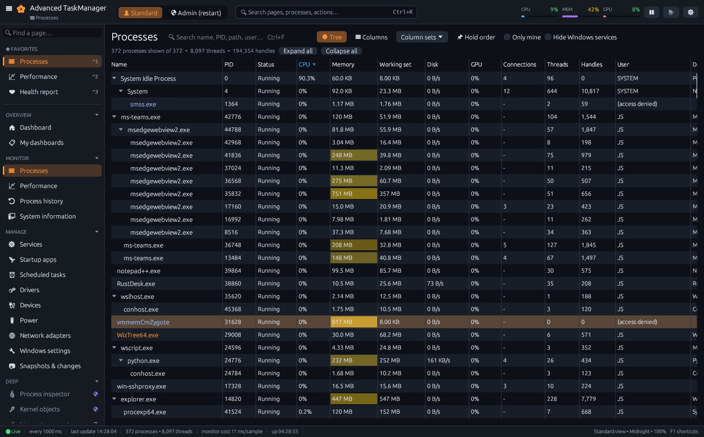
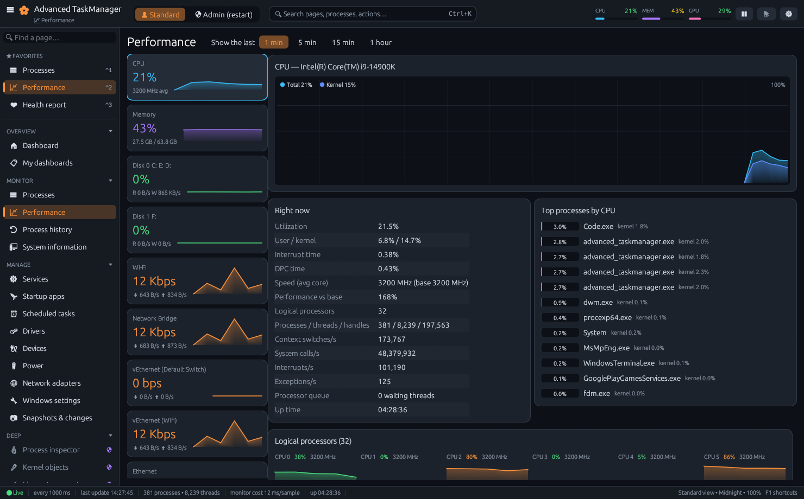
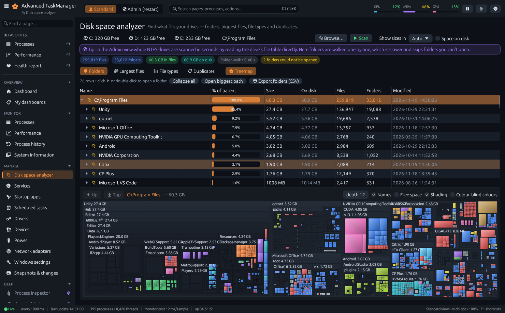
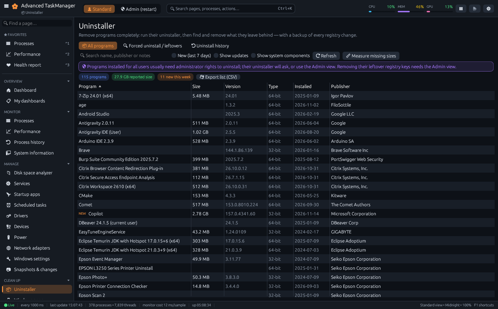
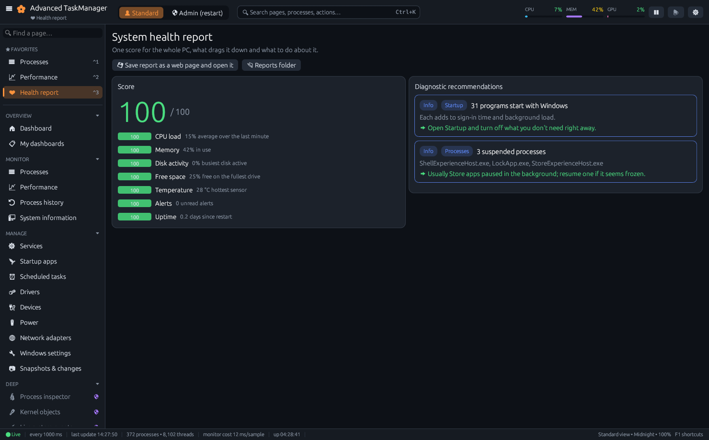
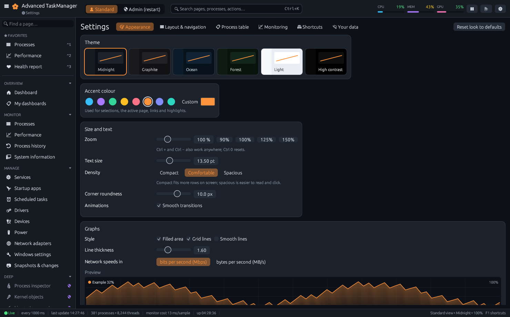

# Advanced TaskManager — User Guide

This guide walks through every part of the app in plain language. No technical knowledge needed.

- [1. First start](#1-first-start)
- [2. The window](#2-the-window)
- [3. Standard view and Admin view](#3-standard-view-and-admin-view)
- [4. Overview pages](#4-overview-pages)
- [5. Monitor pages](#5-monitor-pages)
- [6. Manage pages (incl. Disk space analyzer)](#6-manage-pages)
- [7. Clean up pages (Uninstaller and cleaners)](#7-clean-up-pages)
- [8. Deep pages](#8-deep-pages)
- [9. Insights pages](#9-insights-pages)
- [10. Automate pages](#10-automate-pages)
- [11. Settings and personalising](#11-settings-and-personalising)
- [12. Keyboard shortcuts](#12-keyboard-shortcuts)
- [13. Your data and safety nets](#13-your-data-and-safety-nets)
- [14. FAQ and troubleshooting](#14-faq-and-troubleshooting)

A one-page list of every page and what it needs is in [FEATURES.md](FEATURES.md).

---

## 1. First start

Double-click `advanced_taskmanager.exe`. The app opens on the **Dashboard** in the **Standard view**. It starts measuring straight away; graphs fill up over the first minute and the "intelligence" pages become more accurate the longer it runs.

There is nothing to install and nothing runs after you close the window.

## 2. The window

- **Top bar** — the ☰ button collapses the sidebar; the current page name; the **Standard / Admin** switch; the search box (**Ctrl+K**) that finds any page, process or action; live CPU, memory and GPU meters; pause (⏸); alerts (🔔); settings (⚙).
- **Sidebar** — every page, grouped. **★ Favorites** sit at the top (Ctrl+1…9 opens them). Click a group title to fold it. Right-click any page to add it to favorites, make it the start-up page or hide it. Pages marked 🛡 need the Admin view.
- **Status bar** — live/paused state, sampling speed, last update, process and thread counts, how much CPU the monitor itself uses, and up time.
- **Notifications** appear in the bottom-right corner when an action succeeds or fails.

## 3. Standard view and Admin view

| | Standard view | Admin view |
|---|---|---|
| Needs administrator rights | No | Yes (Windows asks once) |
| Process columns | 17 everyday columns | 44 columns (kernel time, page faults, pools, integrity, command line, …) |
| Process detail tabs | General, Performance, Network, History | + Threads, Modules, Memory map, Handles, Security |
| Control | Your own processes | All processes, services, drivers, adapters, tasks |
| Extra pages | — | Process inspector, Kernel objects, Live system events |
| Extra data | — | Security event log, SSD wear/temperature, detailed ACPI temperatures, battery wear, boot timings |
| Disk space analyzer | Walks folders you can open | Reads a whole NTFS drive's file table in seconds, including system folders |
| Uninstaller & cleaners | Your own programs and files; leftovers under your user | Programs for all users, leftover keys under HKLM, Windows temp and update caches, restore points, Store apps for all users |

Click **🛡 Admin** in the top bar. If the app is not already running as administrator, it offers to restart itself; accept the Windows prompt. Click **👤 Standard** any time to go back to the simpler view.

## 4. Overview pages

### Dashboard
Five tiles (CPU, memory, disk, network, GPU) — click one to open its performance page. Below: the **health score**, a **system summary**, **what's slowing things down**, two-minute graphs, the top processes by CPU, memory and disk, the latest events and your drives.
**⚙ Customize** (top-right) hides or shows each section.

### My dashboards
Build your own dashboards from 15 widgets (graphs, CPU cores, top lists, alerts, health, drives, temperatures, events…). Press **✏ Edit**, add widgets, reorder them with ◀ ▶, choose 1–4 columns and give it a name. Make as many dashboards as you like.

## 5. Monitor pages

### Processes

- **Search** (Ctrl+F) matches name, PID, publisher, path, user and command line.
- **🌳 Tree** shows which process started which; ⏷/⏵ fold branches.
- **☰ Columns** picks columns and their order; **Column sets ⏷** switches between ready-made sets (Everyday, Memory detail, Disk & I/O, CPU & threads, Graphics & network, Security, Who made it).
- **📌 Hold order** stops rows moving while you read; values keep updating.
- **Only mine** / **Hide Windows services** filter the list.
- Coloured cells show heavy use (yellow → orange → red). Orange names run as administrator, blue names are Windows services, grey names are suspended.
- **Click a row** to open the details panel; drag its top edge to resize. **Right-click** a row for actions:
  - End task / End process tree
  - Set priority, Efficiency mode on/off
  - (Admin) Suspend/Resume, CPU affinity, Create dump file, Open in inspector
  - Open file location, File properties, Copy details

**Detail tabs**
- *General* — description, publisher, version, path, command line, user, parent, start time, priority class, efficiency mode, GDI/USER objects; in Admin view also I/O and memory priority, protection level, "critical process" flag and CPU affinity editor.
- *Performance* — CPU, memory, disk and handle graphs and lifetime I/O totals.
- *Threads* (Admin) — every thread with state, wait reason, CPU, priority, context switches per second, start address (e.g. `ntdll.dll+0x24990`) and name; suspend or resume a single thread.
- *Modules* (Admin) — every DLL with address, size, description, publisher and version; non-Microsoft modules are highlighted.
- *Memory map* (Admin) — every memory region with state, type, protection and mapped file; summaries per type and a count of executable+writable regions.
- *Handles* (Admin) — every open handle with type, access and name (files, registry keys, events, sections…).
- *Network* — connections and listening ports.
- *Security* (Admin) — user, SID, integrity level, elevation, token type, privileges and groups.
- *History* — peaks, averages and events for this process.

### Performance

Pick CPU, memory, each disk, each network adapter or the GPU on the left. Choose a 1 min, 5 min, 15 min or 1 hour window.
- **CPU** — total and kernel time, interrupt and DPC time, speed vs base, context switches, system calls, interrupts, run queue and every logical processor.
- **Memory** — in use, modified, standby, free, compressed, committed, cache, kernel pools, page faults and hard paging, plus the top memory users.
- **Disk** — active time, read/write speed, queue length, response time, top processes, drives.
- **Network** — receive/send, link speed, totals, errors, discards, processes with most connections.
- **GPU** — each engine (3D, copy, video…), dedicated and shared memory, top GPU processes.

### Process history
Every process that started or exited while the app was open, with exit time, lifetime, peak CPU and peak memory.

### System information
Computer, operating system, firmware and motherboard, processor, memory modules, graphics, disks, monitors and sound devices.

## 6. Manage pages

### Disk space analyzer

Find out what fills your drives.

1. Click a drive button (it shows the free space) or type/browse to a folder, then press **▶ Scan**. Press **■ Cancel** to stop.
   - In the **Admin view** a whole NTFS drive is scanned in seconds by reading the drive's file table directly — including system folders normal users can't open.
   - In the Standard view folders are walked with several threads; folders you can't open are counted and skipped.
2. The summary shows files, folders, total size, space on disk, how the scan was done and how long it took. For a whole drive it also shows used and free space and how much Windows uses outside visible files.
3. Explore with the tabs:
   - **🌳 Folders** — the tree, biggest first, with a bar for each item's share of its parent folder, size, space on disk, file and folder counts and the newest change inside. **Open biggest path** unfolds the largest folder at every level.
   - **📄 Largest files** — the biggest files anywhere. Search by name or part of a name, use wildcards (`*.mp4`, `backup??.zip`), tick **Match whole path** to search folder names too, and use **Only** / **Skip** with patterns like `*.iso; *.zip`. Choose how many to show (100 to All).
   - **📊 File types** — space per extension with colours that match the treemap. Click a type to list those files.
   - **📋 Duplicates** — files with the same name and size (optionally also the same date) and how much space keeping one copy would free.
4. **💠 Treemap** (bottom) — every folder and file as a rectangle sized by how much space it takes, coloured by file type. Hover for details, click to find the item in the tree, double-click to zoom into a folder, **⬆ Up** / **⏫ Top** or the path to go back. Options: names, shading, free space block, colour-blind colours, depth.
5. **Right-click** any folder or file (in any tab or the treemap) to show it in Explorer, open it, open a command prompt there, copy its path or name and size, find it in the tree or treemap, or **move it to the Recycle Bin** (you're asked first, and you can restore it from the Recycle Bin).
6. **Show sizes in** switches between automatic units, bytes, KB, MB, GB or TB; **Space on disk** uses the space files really take (clusters, compression) instead of their length. **Export** buttons save CSV files you can open in Excel.

Tip: start the app with `--scan D:\` to open this page and scan straight away.
| Page | What you can do |
|---|---|
| **Services** | See all services; filter; start, stop, restart (Admin); set Automatic, Manual or Disabled (Admin); show dependencies; jump to the service's process. |
| **Startup apps** | Everything that starts with Windows — Run keys, startup folders, logon tasks and third-party auto-start services. Enable/disable exactly like Task Manager (all-users entries need Admin). |
| **Scheduled tasks** | All tasks with triggers, actions and account; last/next run; run or end now; enable/disable (Admin). |
| **Drivers** | Driver services; signed device drivers (unsigned ones in red); modules loaded in the kernel (addresses in Admin). |
| **Devices** | Every device with class, maker, driver service and problem description; filter to devices with problems. |
| **Power** | Power plans (switch with one click), active plan settings, battery, sleep states, detailed battery report. |
| **Network adapters** | Live traffic per adapter, driver details, IP addresses, DNS servers, gateways and network profiles; enable/disable (Admin). |
| **Windows settings** | UAC, Secure Boot, Defender, virtualization-based security, firewall, BitLocker, fast start-up, game mode, GPU scheduling, page files, latest updates, enabled features, environment variables. |
| **Snapshots & changes** | Save the state of services, drivers, startup, tasks, programs, updates, adapters and devices; compare any two to see what was added, removed or changed. |

## 7. Clean up pages

### Uninstaller
- **All programs** lists everything installed for all users and for you, with size, version, 32/64-bit, install date and publisher. Search, show only programs **new in the last 7 days**, or include Windows updates and system components. **Measure missing sizes** adds up folders for programs that don't report a size. Click a column title to sort; **Export list** saves a CSV.
- Select a program to see its details and choose:
  - **Uninstall** — runs the program's own uninstaller (answer its questions in its window). When it finishes, the app scans for leftovers.
  - **Quick uninstall** — silent removal where the program supports it.
  - **Forced uninstall** — skips the uninstaller (for broken programs) and goes straight to the leftover scan.
  - **Remove entry only** — deletes a dead entry from the list (backed up first).
  - Open its folder, its registry entry or its website. Tick **Create a restore point first** for extra safety (Admin view).
- **Leftover scan** looks in the registry, Program Files, ProgramData, your app data, the Start menu, the desktop and (Advanced) services. **Safe** finds exact names only, **Moderate** (recommended) also names that start like the program, **Advanced** goes deepest. Untick anything you're unsure about. Items that another installed program also uses are listed but left unticked, with a note.
- **Delete selected**: every registry key is exported to a backup first (see Backups & restore); files and folders go to the Recycle Bin.
- **Forced uninstall / leftovers** tab: type a name (and optionally publisher and folder) to clean up after a program that's no longer listed.
- **Uninstall history** lists what you removed, when, and how much was cleaned.

### Windows apps
Store apps and built-in apps. Hide or show system parts and frameworks; uninstall the ones you don't use (Admin view: for all users).

### Browser extensions
Every extension in Chrome, Edge, Brave, Vivaldi, Opera and Firefox, per profile, with on/off state where known. Close the browser, then **Remove** (files go to the Recycle Bin). If you use browser sync, also remove it in the browser.

### Junk files cleaner
Sizes of temporary files, Windows temp (Admin), thumbnail cache, error reports, crash dumps, graphics shader caches, browser caches, Windows Update downloads (Admin), delivery cache (Admin), setup logs (Admin) and the Recycle Bin. "Only files older than one day" is on by default. Files in use are skipped. **Open Windows Disk Cleanup** handles old Windows installations.

### Privacy cleaner
Clears the recent files list, jump lists, Run box history, Explorer typed addresses and search history, the clipboard and the DNS cache. Browser history is cleared inside each browser.

### Secure delete
Add files or folders and **Delete for good**: each file is overwritten (1, 3 or 7 passes), renamed and deleted, so recovery tools can't restore it. On SSDs, use BitLocker for reliable protection.

### Backups & restore
Registry backups made by the uninstaller (restore with one click; files come back from the Recycle Bin) and Windows restore points (Admin view: list and create; **Open System Restore** to go back).

### Windows tools
One-click access to 23 built-in tools: System Configuration, Disk Cleanup, Defragment, System Restore, Device Manager, Event Viewer, Services, Computer Management, Disk Management, Registry Editor, Task Scheduler, Resource Monitor, Reliability Monitor, System Information, Windows Security, Network Connections, Programs and Features, Power Options, Firewall, DirectX Diagnostics, Memory Diagnostic, Command Prompt and PowerShell.
## 8. Deep pages

| Page | What it shows |
|---|---|
| **Process inspector** 🛡 | A full-screen version of the process detail tabs with a process picker. |
| **Kernel objects** 🛡 | Every kernel object type with object and handle counts, and which processes hold the most handles. |
| **Live system events** 🛡 | A live Event Tracing for Windows session. Choose sources (process/thread starts, DLL loads, network, DNS, new/deleted files, power, PowerShell), press **Start**, filter, click an event for all its fields. |
| **Event Viewer** | Critical, error, warning or information events from System, Application, Security (Admin) and other logs, for the last 1 hour to 30 days. |
| **Diagnostics timeline** | Everything in order — starts, exits, spikes, alerts, automation, snapshots and Windows errors — over a CPU strip. |
| **Recording** | Record every counter to a CSV file for 1 min to 1 hour or until stopped; reopen recordings in Historical graphs or Excel. |
| **Historical graphs** | Up to one hour of CPU, memory, commit, disk, network, GPU, temperature and process count, or a saved recording. |
| **Hardware sensors** | Thermal zones, per-core clocks, fans, battery charge/discharge and wear, NVIDIA GPU temperature/power/clocks when NVIDIA's tools are installed. |
| **Disk health** | Each drive's health status; in Admin view also wear, temperature, power-on hours, read/write errors and latency; SMART failure prediction; TRIM status. |

## 9. Insights pages

- **Health report** — a 0–100 score from CPU load, memory, disk activity, free space, temperature, alerts and uptime, with recommendations. **Save report as a web page** writes a shareable HTML report.
- **Bottlenecks** — checks the processor, run queue, driver time, memory, commit, paging, every disk, free space, network links, GPU, heat and throttling, and names the processes responsible.
- **Process behaviour** — labels each process: CPU-bound, bursty, disk-heavy, memory/handles/threads growing, GPU user, network-chatty, page-fault heavy, idle or steady.
- **Leak candidates** — processes whose memory, handles or threads rise steadily, with the growth rate and how well a straight line fits.
- **Startup analysis** — enabled startup entries ranked by estimated impact, and recent boot times (Admin).
- **Correlated events** — each unusual spike with what happened within five seconds.
- **Change impact** — differences between two snapshots and how load changed.

## 10. Automate pages

### Rules
"When *this* stays *above/below* a value for *N seconds*, do *that*." Conditions: system CPU, memory, commit, disk, GPU, network, temperature, or a process's CPU, memory, handles, threads, disk I/O, start or exit (name patterns with `*`). Actions: alert, end, suspend, set priority, efficiency mode, run a script, record performance, apply a system profile. A cool-down stops repeats.

### Alerts
Everything your rules raised; acknowledge one or all; filter by severity.

### Profiles
- **System profiles** — one click switches power plan, ends or re-prioritises named apps and changes sampling speed (examples: Gaming, Quiet/battery, Balanced).
- **Process profiles** — every time an app starts, give it a priority, CPU set or efficiency mode automatically.

### Scheduled monitoring
Every N minutes or daily at a time: record performance, take a snapshot and/or write a health report (while the app is open).

### Scripts
Save PowerShell or cmd scripts and run them with output shown; rules pass `DTM_RULE`, `DTM_PID`, `DTM_NAME` and `DTM_VALUE`. **Export live data as JSON** for other tools.

## 11. Settings and personalising

- **Appearance** — themes (Midnight, Graphite, Ocean, Forest, Light, High contrast), accent colour, zoom, text size, density, corner roundness, animations, graph fill/grid/smoothing/thickness, network units.
- **Layout & navigation** — icons-only sidebar, status bar, start-up page, notification time, favorites order, which pages appear, which Dashboard sections appear.
- **Process table** — heat colours, name colours, details panel height, column sets, confirmation before ending processes.
- **Monitoring** — update speed (0.25–5 s) and its CPU cost, pause.
- **Shortcuts** and **Your data** (open the data folder, save or back up settings).
- **Reset look to defaults** restores appearance while keeping your favorites.

## 12. Keyboard shortcuts

| Keys | Action |
|---|---|
| Ctrl+K | Command palette |
| Ctrl+F | Search processes |
| Ctrl+P | Pause / resume |
| Ctrl+B | Sidebar |
| Ctrl+1…9 | Favorites |
| Ctrl + / − / 0 | Zoom |
| Delete | End selected process |
| Esc | Close |
| F1 | Shortcut list |

## 13. Your data and safety nets

Everything the app saves stays on your PC in `%APPDATA%\AdvancedTaskManager` (Settings → Your data → **Open folder**):

| Item | What it is | Created when |
|---|---|---|
| `config.json` | All settings, rules, profiles, schedules, scripts, dashboards and look | You change something |
| `backups\<date>-<program>\` | `.reg` copies of registry keys the Uninstaller removed, plus `manifest.json` | You delete leftovers or remove an entry |
| `uninstall-history.json` | The Uninstall history list | You uninstall something |
| `snapshots\` | Configuration snapshots | You or a schedule take one |
| `recordings\` | Performance recordings (CSV) | You record |
| `reports\` | Health and battery reports (HTML) | You save one |
| `exports\` | CSV/JSON exports (programs, disk lists, live data) | You export |
| `dumps\` | Process memory dumps | You create one (they can contain private data) |

**Safety nets when removing things**

- Uninstalling uses the program's own uninstaller first.
- Registry keys are always exported to a backup before they are deleted — restore them from **Backups & restore**.
- Files and folders removed by the Uninstaller, Disk space analyzer and Browser extensions go to the **Recycle Bin**.
- Leftovers that another installed program also uses are shown but **not ticked**.
- Anything inside the Windows folder is never offered as a leftover, and Secure delete refuses drive roots and the Windows folder.
- **Permanent** deletions — Junk files cleaner, Privacy cleaner, Secure delete and emptying the Recycle Bin — always ask first.
- Optional Windows restore point before an uninstall (Admin view).
## 14. FAQ and troubleshooting

**Why do some processes say "access denied"?** Windows protects processes of other users and the system. Switch to the Admin view.

**Why is CPU 0% for the first second?** Usage is the difference between two measurements; the first appears after one sample.

**Why are fan speeds or voltages "not available"?** Most PCs don't report them to Windows; only vendor tools with special drivers can read them.

**Why can't I see bandwidth per app?** Windows doesn't count network bytes per process by default. The Network tab shows each app's connections; the Live system events page (Admin) shows network activity per process.

**A page says "Reading from Windows…" for a while.** Pages like Services, Devices and Windows settings ask Windows' management tools, which can take 5–30 seconds the first time.

**Does it slow my PC down?** The status bar shows the monitor's own cost per sample (typically about 10–15 ms each second on one core). Raise the update interval in Settings → Monitoring to make it even lighter.

**How do I remove everything?** Delete the program file and the folder `%APPDATA%\AdvancedTaskManager`.

**Is the Uninstaller safe to use?** It runs each program's own uninstaller and only then looks for leftovers. You see every leftover before anything is removed; registry keys are backed up and files go to the Recycle Bin. Start with the **Moderate** scan and untick anything you don't recognise.

**I removed a leftover and something stopped working.** Open **Backups & restore**, find the program and press **Restore registry keys**; restore files from the Recycle Bin. If you made a restore point, **Open System Restore** can roll back the whole system.

**An uninstaller closed straight away but the program is still there.** Some uninstallers hand over to a second process. Wait for it to finish, then press **It has finished — scan for leftovers**.

**Why does a scan of C:\ take long or say folders couldn't be opened?** In the Standard view the Disk space analyzer walks folders one by one and can't open protected ones. The Admin view reads the drive's file table directly and is much faster and complete.

**The Junk cleaner says "partly unreadable".** Some folders are locked or belong to the system; they're skipped safely. The Admin view can clean more of them.

**A removed browser extension came back.** Browser sync restores it. Remove it in the browser's own extensions page while signed in.

**Secure delete on an SSD?** SSDs move data internally, so overwriting can't guarantee every copy is gone. Use BitLocker (full-disk encryption) for reliable protection.